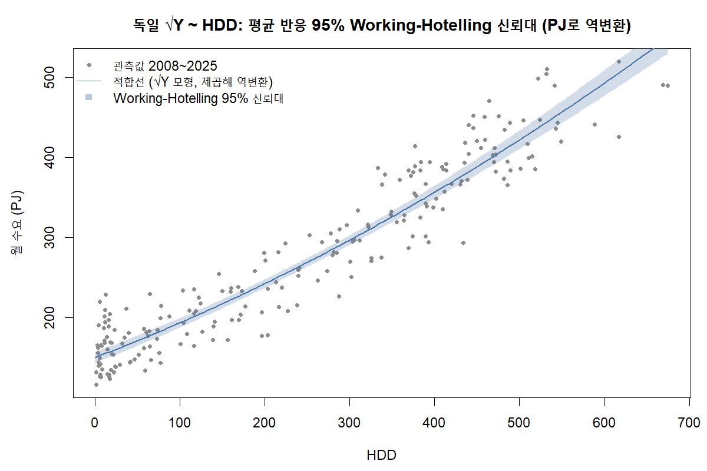
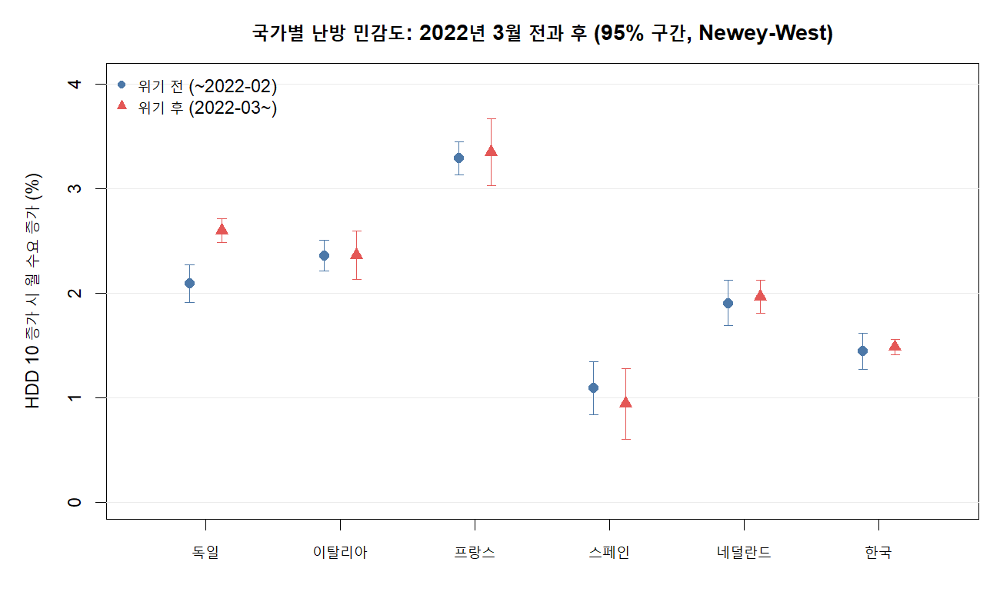
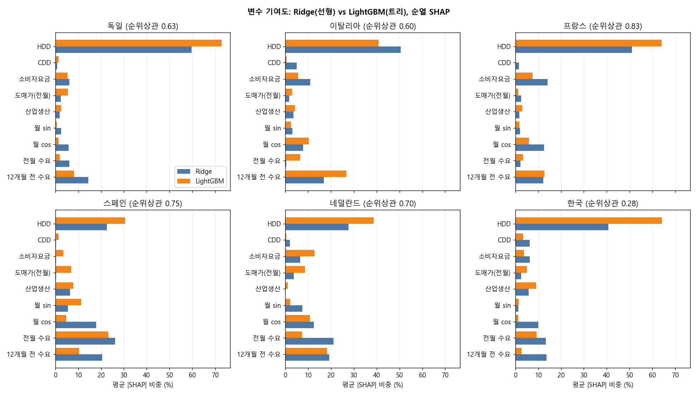

# 천연가스 월 수요예측: 독일 중심 6개국, 회귀분석과 AI 모델 비교

독일 월별 천연가스 수요를 회귀분석(강의 Ch1~6)과 AI 모델로 예측하고, 같은 모델 구조를 이탈리아·프랑스·스페인·네덜란드·한국에 적용해 국가별 정확도와 난방 민감도를 비교한다.

- 평가: 2023년 1월~2025년 12월, 매달 재추정 후 1개월 앞 예측(36회), MAPE·RMSE·MASE, Diebold-Mariano 검정
- 도구: 회귀 R, AI Python

## 폴더 구조

```
data/
  raw/<호출일>/        원자료 그대로 (Eurostat JSON-stat, FRED CSV)
  interim/             long 형식 정리본 (europe_long.csv)
  processed/           국가별 분석 데이터셋 (DE.csv … panel.csv)
python/
  config.py            경로·국가·기간 설정
  fetch_europe.py      유럽 5개국 + FRED 수집
  fetch_korea.py       한국: KOGAS 공급량(키 불필요), 기상청 HDD·CDD·KOSIS(키 필요)
  fetch_the.py         독일 부문별: THE 일별 SLP·RLM → 월 PJ (키 불필요, 2021-10~)
  fetch_dwd.py         독일 2026년 HDD·CDD: DWD 12개 도시 일평균기온 → Eurostat 값에 보정 (R² 0.999)
  build_dataset.py     국가별 월 데이터셋 병합 (영업일 수, 2026년 HDD·요금 연결 포함)
  rolling_eval.py      공통 롤링 평가 코드 (사후·사전예측, MAPE·RMSE·MASE)
  models.py            모델 정의 (회귀·Ridge·Lasso·RF·GBM·LightGBM·SVR·MLP·SARIMAX·Holt-Winters·하이브리드)
  dm_test.py           Diebold-Mariano 검정 (HLN 보정)
  run_experiment.py    본 실험: 튜닝 → 고정 → 6개국 평가 → DM 검정
  r1_variables_de.py   R1 변수 설계: 독일 외부 변수를 같은 튜닝 절차로 평가
  r2_structural.py     R2 구조변화: 확장창·이동창·지수가중·위기 변수 비교 (6개국)
  r3_shap.py           R3 해석가능성: Ridge vs LightGBM 순열 SHAP 기여도 (6개국)
  r6_global.py         R6 6개국 통합 모델 vs 국가별 모델
  r7_sector.py         R7 부문별 예측: 부문 합산 vs 총량 직접 (독일·한국), 부문별 민감도
  r8_foundation.py     R8 파운데이션 모델 Chronos-2·TimesFM 2.5 zero-shot (.venv-fm에서 실행)
  r9_intervals.py      R9 예측구간: 회귀 PI·분위수 GBM·conformal·Chronos-2 분위수의 포함률
  r10_ensemble.py      R10 앙상블: 사전에 정한 구성의 단순 평균 vs 단일 모델
  r11_climate.py       R11 기후 시나리오: 겨울·난방철 HDD −10% → 연간 수요 변화
  oos_de2026.py        독일 2026-01~09 표본 외 검증
  r4_mcs.py            R4 모델 신뢰집합 (25개 후보, 다중비교 보정)
  realtime_check.py    공표 지연을 반영한 실시간 예측 견고성 확인
  leakage_check.py     데이터 누수 자동 점검 (미래 자료를 망가뜨려도 예측이 그대로인지)
  run_all.py           분석 전체를 의존 순서대로 실행
  pre_experiment_de.py 계획서의 독일 사전 실험(기본 설정) 재현
  sensitivity_de.py    독일 ML 모델 설정 민감도
R/
  01_de_simple_regression.R   독일 단순회귀 추론(Ch1~2, HAC 병기), 진단 plot 6종·검정·적합결여·Box-Cox(Ch3)
  02_de_multiple_regression.R 독일 다중회귀(Ch6~): 부분 F·VIF·모든 부분집합 선택·HAC 표준오차·추가변수 plot
  03_country_regression.R     R5 국가별 회귀: HDD 민감도·요금 탄력성·위기 효과 비교
  04_de_simultaneous_matrix.R Ch4~5: Bonferroni·Working-Hotelling·겨울 3개월 동시예측·역예측·행렬 계산
  05_structural_break.R       구조변화 검정: Chow(2022-03)·sup-F·Bai-Perron (6개국)
docs/
  API_KEYS.md          기상청·KOSIS API 키 발급 절차
outputs/
  experiment/          본 실험 결과 (report.md, summary.csv, predictions.csv, dm_tests.csv, tuning.csv)
  figures/             그림
```

## 실행 순서

```bash
# 1) 환경
pip install -r requirements.txt
#    R: install.packages(c("lmtest", "car", "sandwich", "strucchange"))
#    R8 파운데이션 모델은 별도 가상환경 (torch·transformers가 기본 환경과 충돌하지 않게)
py -3.12 -m venv .venv-fm
.venv-fm\Scripts\python -m pip install torch --index-url https://download.pytorch.org/whl/cpu
.venv-fm\Scripts\python -m pip install chronos-forecasting==2.3.2 "timesfm[torch]==3.0.2" jax scikit-learn pandas scipy

# 2) 데이터 (저장소에 2026-11-21 호출본이 이미 들어 있다. 새로 받을 때만)
cd python
python fetch_europe.py        # 유럽·FRED (data/raw/<오늘 날짜>/ 에 원자료 저장)
python fetch_korea.py all     # 한국: KOGAS·기상청·KOSIS (키는 docs/API_KEYS.md, 키 없으면 kogas만 가능)
python fetch_the.py           # 독일 부문별 THE SLP·RLM
python fetch_dwd.py           # 독일 2026년 HDD (DWD 보정)
python build_dataset.py       # data/processed/ 생성
cd ..

# 3) 분석 전체 (본 실험 → 누수 점검 → R 스크립트 → R1~R11 → MCS → 실시간 → 2026 검증, 12코어 약 30분)
python python/run_all.py
python python/run_all.py --from r9    # 특정 단계부터
```

단계별 결과 위치: 본 실험 `outputs/experiment/report.md`, 각 연구 과제 `outputs/r*.md`, 회귀 추론 `outputs/de_*.txt`, 그림 `outputs/figures/`.

TimesFM의 `timesfm[xreg]`는 Windows에 없는 `jax[cuda]`를 요구해서, CPU용 `jax`를 따로 설치한다.

보조 스크립트: `pre_experiment_de.py`(계획서 기본 설정 재현), `sensitivity_de.py`(설정 민감도).
특정 Eurostat 계열만 새로 받기: `python fetch_europe.py wind_gwh` (다른 계열은 수정치로 바뀌지 않는다).

R 패키지: `install.packages(c("lmtest", "car", "sandwich", "strucchange"))` (MASS는 기본 포함)

## 새 모델을 평가하는 법

모든 모델은 `rolling_eval.py`의 같은 평가 코드를 쓴다. 모델은 `fit_predict(train, test, features, target)` 함수 하나로 만든다.

```python
from rolling_eval import load_country, rolling_forecast, metrics, BASE_FEATURES

def my_model(train, test, features, target):
    ...  # train으로만 적합 (표준화도 train으로만)
    return 예측값_배열   # test 행 수만큼

df = load_country("DE")
res = rolling_forecast(df, my_model, BASE_FEATURES, modes=("ex_post", "ex_ante"))  # 2023-01~2025-12, 36회
print(metrics(res[res["mode"] == "ex_post"], df))     # MAPE, RMSE, MASE
```

본 실험에 넣으려면 `run_experiment.py`의 `SPECS`에 `Spec(이름, 특성, build=..., grid=...)` 한 줄을 추가한다. 하이퍼파라미터는 2020~2022 검증 구간에서만 고르고, 2023~2025 평가 구간은 튜닝에 쓰지 않는다.

## 데이터

| 변수 | 유럽 5개국 | 한국 |
| --- | --- | --- |
| 변수 (공통 열 이름) | 유럽 5개국 | 한국 |
| --- | --- | --- |
| 수요 `y` | Eurostat `nrg_cb_gasm` 내수 소비 (PJ, GCV), 2008-01~ | KOGAS 용도별 월 공급량 도시가스용+발전용 (천 톤), 2016-01~ |
| `hdd`, `cdd` | Eurostat `nrg_chdd_m` | 기상청 ASOS 7개 도시(서울·부산·대구·인천·광주·대전·울산) 일평균기온으로 Eurostat 방식 계산, 지점 평균 |
| `price_retail` | Eurostat `prc_hicp_midx` CP0452 (2015=100) | KOSIS 소비자물가 도시가스 `DT_1J22112` (2020=100) |
| `price_wholesale` | FRED `PNGASEUUSDM` (USD/MMBtu) | FRED `PNGASJPUSDM` 아시아 LNG (USD/MMBtu) |
| `ip` | Eurostat `sts_inpr_m` B-D 계절조정 (2021=100) | KOSIS 광공업생산지수 계절조정 총지수 `DT_1F02001` (2020=100) |
| `ip_chem` | Eurostat `sts_inpr_m` C20 | — |
| `nuclear_gwh` | Eurostat `nrg_cb_pem` N9000 (GWh) | — |
| `workdays` | python-holidays 국가 공휴일 | 같음 (설·추석·대체공휴일 포함) |

- 한국 HDD: HDD = Σ(18 − Tm) (Tm ≤ 15°C인 날), CDD = Σ(Tm − 21) (Tm ≥ 24°C인 날)을 지점별로 월합한 뒤 7개 지점을 단순평균한다. 일평균기온 결측 2일(2011-10-16 인천, 2013-09-30 대구)은 앞뒤 날로 보간했다.
- Eurostat `prc_hicp_midx`는 2025년 12월에서 끝난다(COICOP 개편). 2026년 추가 검증에는 대체 출처가 필요하다.
- 한국 소비자 도시가스 요금은 규제 요금이라 몇 달에 한 번만 바뀐다.

## 진행 상황

- [x] 유럽 5개국 + FRED 데이터 수집 (2026-11-21 호출, 2008-01~2025-12 결측 없음)
- [x] 한국 데이터: KOGAS 공급량, 기상청 7개 도시 HDD·CDD, KOSIS 도시가스 CPI·광공업생산지수 (2016-01~2025-12 결측 없음)
- [x] 국가별 데이터셋 병합 (2025년 소비량·최대월/최소월 비 계획서와 일치)
- [x] 공통 롤링 평가 코드 (사후·사전예측)
- [x] 독일 단순회귀 추론·진단·Box-Cox (R)
- [x] 본 실험: 6개국 × 13개 모델, 검증 구간 튜닝, 시드 평균, DM 검정 (R4·R5 일부)
- [x] 독일 부문별 자료 THE SLP·RLM (2021-10~, Eurostat 총량과 상관 0.995), 부문별 예측 (R7)
- [x] 독일 다중회귀·VIF·변수선택·HAC (Ch6~), 외부 변수 평가 (R1)
- [x] 국가별 회귀계수·HDD 민감도 비교 (R5), 구조변화 대응 (R2)
- [x] 6개국 통합 모델 (R6), SHAP 해석 (R3)
- [x] 파운데이션 모델 Chronos-2·TimesFM 2.5 zero-shot (R8)
- [x] 예측구간 (R9), 앙상블 (R10), 기후 시나리오 (R11), 독일 2026년 표본 외 검증
- [ ] 최종 산출물: 논문 형식 보고서, 학술대회 발표 자료와 스크립트

## 본 실험 결과 (6개국) — `outputs/experiment/report.md`

2023~2025년 롤링 1개월 앞 사후예측 MAPE(%). 하이퍼파라미터(ML)와 차수·형태(SARIMAX, Holt-Winters)는 모두 2020~2022년 검증 구간에서만 골랐다.

| 모델 | 독일 | 이탈리아 | 프랑스 | 스페인 | 네덜란드 | 한국 | 평균 |
| --- | --- | --- | --- | --- | --- | --- | --- |
| 기준: 회귀 √Y~HDD+가격 | 6.5 | 9.1 | 10.0 | 9.8 | 17.1 | 4.6 | 9.5 |
| SARIMAX+HDD·가격 | 5.7 | **4.3** | 6.9 | **6.0** | 7.6 | **4.5** | **5.9** |
| Holt-Winters | 9.2 | 4.8 | 13.1 | 6.0 | **6.0** | 6.0 | 7.5 |
| Ridge | 5.6 | 5.6 | 7.1 | 9.2 | 10.5 | 6.6 | 7.4 |
| Gradient Boosting | 5.8 | 5.7 | 7.0 | 6.3 | 7.5 | 5.1 | 6.2 |
| LightGBM | **5.3** | 5.3 | 10.2 | 7.6 | 7.5 | 6.1 | 7.0 |
| MLP (16-8) | 5.8 | 5.6 | 7.1 | 7.3 | 8.8 | 5.3 | 6.7 |
| 하이브리드 (회귀+GBM 잔차) | 6.3 | **4.3** | **6.5** | 7.5 | 7.9 | 4.6 | 6.2 |

- **최고 단일 모델이 국가마다 다르다.** 독일은 LightGBM, 이탈리아는 SARIMAX·하이브리드, 프랑스는 하이브리드, 스페인은 SARIMAX·Holt-Winters, 네덜란드는 Holt-Winters, 한국은 SARIMAX다.
- **검증 구간에서 차수를 고른 SARIMAX(계절 차분 (0,1,1)₁₂)가 학습형 단일 모델 중 평균 1위다**(사후 5.9%, 사전 7.1%). 처음 실행에서 차수를 고정했을 때(평균 7.4%)는 ML보다 낮게 나왔는데, 같은 튜닝 절차를 적용하자 순위가 바뀌었다 (아래 '연구 검토와 보완').
- **기준 회귀는 수요 수준이 구조적으로 바뀐 나라에서 크게 틀린다.** 네덜란드 17.1%, 프랑스 10.0%. 전월 수요나 계절 차분을 쓰는 모델은 이 변화를 따라간다.
- **한국은 HDD 하나로 충분하다.** 단순회귀 4.6%보다 유의하게 정확한 모델이 없다.
- **36개월 평가로는 상위 모델끼리 구분하기 어렵다.** 모델 신뢰집합(MCS, 아래)에 국가마다 25개 후보 중 14~21개가 남는다.
- **사전예측(평년 HDD)에서는 트리 모델이 크게 나빠진다**(독일 GBM 5.8% → 9.2%). SARIMAX·MLP·하이브리드가 더 안정적이다. MLP는 시드에 따라 MAPE가 ±0.4~1.3%p 흔들린다.

## 연구 검토와 보완 (2026-11-21)

최종 보고서 작성 전에 데이터 → 평가 설계 → 모델 → 회귀 추론 → 결과 해석 → 재현성 순으로 다시 점검했다.

| 단계 | 발견한 문제 | 조치 | 결과 |
| --- | --- | --- | --- |
| 데이터 | 수요는 1~2개월, 산업생산은 약 2개월 늦게 공표되는데, 사전예측은 '전월 수요를 안다'고 가정했다 | 공표 지연을 그대로 반영한 실시간 예측 추가 (`realtime_check.py`) | MAPE가 평균 0.5~1%p 커지지만 순위는 유지. Chronos-2 + 공변량 7.2%로 1위 |
| 데이터 | 한국 HDD를 7개 도시 단순평균으로 계산 | 인구가중 HDD와 비교 | 설명력 차이 없음(R² 0.894 vs 0.892) → 단순평균 유지 |
| 평가 설계 | ML만 튜닝하고 SARIMAX(차수 고정)·Holt-Winters(형태 고정)는 튜닝하지 않아 비교가 불공정했다 | 같은 검증 구간에서 차수·형태 선택 | SARIMAX 평균 7.4% → 5.9%로 단일 모델 1위. 결론 수정 |
| 평가 설계 | DM 검정을 수십 번 반복해 다중비교 문제가 있었다 | 모델 신뢰집합(MCS, Hansen et al. 2011) 추가 (`r4_mcs.py`) | 튜닝한 SARIMAX와 '회귀(위기)+ML+Chronos' 앙상블만 6개국 사후·사전 모두 MCS에 포함 |
| 평가 설계 | 검증 MAPE가 같은 설정이 여럿이면 실행마다 다른 설정이 뽑힐 수 있었다 | 동점 처리를 고정 (반올림 후 설정 문자열로 2차 정렬) | 재실행해도 같은 결과 |
| 평가 설계 | 누수 점검을 코드 읽기로만 했다 | 미래 자료를 ×10으로 망가뜨려도 예측이 그대로인지 자동 검사 (`leakage_check.py`) | 96건 모두 통과. 일부러 누수를 넣은 모델은 검사에 걸림(검사 자체도 검증) |
| 모델 | 위기 시점(2022-03)을 자료로 확인하지 않았다 | Chow·sup-F·Bai-Perron 구조변화 검정 (`R/05_structural_break.R`) | 이탈리아를 뺀 5개국에서 2022년 변화 확인. 유럽은 2022-07~11에 몰림 |
| 모델 | 위기 시점 선택이 결과를 좌우하는지 | 2022-09 시점으로 견고성 확인 (R2, 2026 검증) | 2026년 MAPE 2.4% vs 2.5%로 사실상 같음 → 사전에 정한 2022-03 유지 |
| 회귀 추론 | 계획서의 Ch4~5(Bonferroni 동시구간, 겨울 3개월 동시예측, 역예측, 행렬 계산)를 빠뜨렸다 | `R/04_de_simultaneous_matrix.R` 추가 | 행렬 계산이 lm()과 1e-13 이내로 일치 |
| 회귀 추론 | 단순회귀 신뢰구간이 잔차 자기상관을 무시했다 | Newey-West 구간 병기, 적합결여 검정 추가 | HAC 표준오차가 OLS의 1.6~1.8배. 적합결여: Y 모형 기각(p = 0.002), √Y 모형 기각 안 됨(p = 0.11) |
| 결과 해석 | R1 외부 변수 비교 50건 중 2건만 유의 | 다중비교 관점에서 재해석 | 우연 기대치(2.5건) 수준 → 외부 변수 효과 없음 결론 강화 |
| 재현성 | 분석이 스크립트 20여 개로 나뉘어 순서를 알아야 했다 | `run_all.py`로 전체를 의존 순서대로 실행 | 12코어 약 30분 |

남은 한계: 평가 기간이 36개월로 짧다. 파운데이션 모델의 사전학습 자료에 평가 기간 통계가 섞였을 가능성을 배제할 수 없다. Eurostat 최근 값은 잠정치(프랑스 3개월, 네덜란드 12개월)이고 2026-11-21 호출본 기준이다. 1개월 앞 예측만 다뤘다.

## R4 모델 신뢰집합 (MCS) — `outputs/r4_mcs.md`

25개 후보(본 실험 13 + 위기 변수 3 + 통합 LightGBM + 파운데이션 4 + 앙상블 4) 중 각국 최고 모델과 통계적으로 구별되지 않는 집합(90%, 손실 APE).

| 6개국 모두 MCS에 포함 | 사후예측 | 사전예측 |
| --- | --- | --- |
| SARIMAX + HDD·가격 (튜닝) | ✓ (평균 5.9%) | ✓ (7.1%) |
| 앙상블: 회귀(위기)+ML+Chronos | ✓ (5.8%) | ✓ (7.3%) |
| 앙상블: 검증 상위 3 | ✓ (5.6%) | |
| Chronos-2 (단변량·공변량), TimesFM 2.5 단변량 | | ✓ (6.4~6.6%) |
| Ridge + 위기 변수 | | ✓ (7.5%) |
| Gradient Boosting (± 위기 변수) | ✓ (6.2%) | |

기준 회귀는 3개국에서 MCS 밖이다. 단일 '최고 모델'보다, MCS에 꾸준히 남는 모델군(튜닝한 SARIMAX, 앙상블, Chronos-2)을 권고하는 것이 통계적으로 맞다.

## 실시간 예측 (공표 지연 반영) — `outputs/realtime_check.md`

예측 시점(t-1월 말)에 실제로 공표된 자료만 쓴다: 수요 t-2(독일·이탈리아·스페인·네덜란드)·t-3(프랑스·한국), 산업생산 t-3, 평년 HDD, 직전 달 요금.

| 모델 | 평균 MAPE 실시간 | 평균 MAPE 사전예측 |
| --- | --- | --- |
| Chronos-2 + 공변량 | **7.2** | 6.4 |
| Chronos-2 단변량 | 7.4 | 6.5 |
| 앙상블 (회귀·ML·Chronos) | 8.0 | 7.3 |
| Ridge + 위기 변수 | 8.0 | 7.5 |
| Holt-Winters | 8.8 | 7.5 |
| 회귀 √Y~HDD+가격 (기준) | 12.1 | 11.8 |

공표 지연을 반영하면 전월 수요에 기대는 트리 모델의 손해가 크다(예: LightGBM 프랑스 13.3% → 16.5%). 파운데이션 모델과 앙상블은 실시간에서도 상위다.

## 구조변화 검정과 Ch4~5 — `outputs/r2_structural_break.txt`, `outputs/de_simultaneous_matrix.txt`

- 2022-03 Chow 검정: 독일 p < 10⁻⁶, 프랑스 0.0008, 스페인·네덜란드·한국 p < 10⁻⁴, 이탈리아 0.34(변화 없음).
- 시점을 모를 때(HAC sup-F): 독일 2022-07, 네덜란드 2022-09. Bai-Perron은 2011~2019년의 변화도 함께 찾는다(계획서의 '2010년대 초 저수요기'와 일치).
- 독일 √Y ~ HDD: β의 Bonferroni 동시구간, Working-Hotelling 신뢰대(W = 2.47 < B = 2.52), 겨울 3개월 동시 예측구간(12월 396 PJ [306, 497] 등), 역예측(350 PJ → HDD 389 [271, 507]).



## 독일 2026년 표본 외 검증 — `outputs/oos_de2026.md`

2023~2025년 평가로 고정한 모델·설정을 그 뒤 2026-01~09(9회)에 그대로 적용했다. 2026년 HDD는 DWD 12개 도시 일평균기온을 Eurostat HDD에 보정한 값(2014~2025 R² 0.999), 소비자요금은 HICP ECOICOP ver.2를 2025-12 비율로 이은 값이다.

| 모델 | 2026 MAPE 사후 | 2026 MAPE 사전 | 2023~2025 MAPE 사후 |
| --- | --- | --- | --- |
| Ridge + 위기 변수 | **2.5** | 4.5 | 5.0 |
| 하이브리드 (회귀+GBM 잔차) | 3.2 | **4.4** | 6.3 |
| 회귀 √Y~HDD+가격 + 위기 변수 | 3.3 | 6.9 | 5.4 |
| LightGBM | 3.7 | 7.0 | 5.3 |
| SARIMAX+HDD·가격 | 4.6 | 5.1 | 5.7 |
| Chronos-2 + 공변량 | 5.3 | 5.9 | 6.9 |
| 회귀 √Y~HDD+가격 (기준) | 5.6 | 9.6 | 6.5 |

- 모델 순위가 2023~2025년과 거의 같다(순위상관 0.84). 평가 기간에 맞춘 결론이 아니다.
- 위기 시점을 2022-09로 바꿔도 Ridge + 위기 변수 2.4%로 같다.
- Ridge + 위기 변수는 9개월만으로도 기준 회귀보다 유의하게 정확하다(DM p = 0.013).

## R8 파운데이션 모델 (zero-shot) — `outputs/r8_foundation.md`

학습 없이 수요 이력(과 공변량)만 넣어 예측했다. CPU에서 6개국 전체가 약 4분이다.

| 모델 | 독일 | 이탈리아 | 프랑스 | 스페인 | 네덜란드 | 한국 | 평균 |
| --- | --- | --- | --- | --- | --- | --- | --- |
| Chronos-2 단변량 | 6.8 | 4.9 | 8.8 | 5.5 | 6.6 | 6.4 | 6.5 |
| Chronos-2 + 공변량 | 6.9 | 4.3 | 5.8 | 6.0 | **5.4** | 5.9 | **5.7** |
| TimesFM 2.5 단변량 | 7.9 | 5.4 | 7.7 | 5.6 | 6.9 | 6.2 | 6.6 |
| TimesFM 2.5 + 공변량 | 7.4 | **4.0** | 7.4 | 5.6 | 9.4 | 4.9 | 6.4 |
| 국가 최고 학습 모델 | 5.3 | 4.3 | 6.5 | 6.0 | 6.0 | 4.5 | 5.4 |

- Chronos-2 + 공변량은 6개국 평균 5.7%로 학습한 국가별 최고 모델(평가 구간에서 고른 것, 평균 5.4%)에 가깝고, 네덜란드에서는 더 낫다(5.4% vs 6.0%). 어느 나라에서도 최고 모델보다 유의하게 나쁘지 않다.
- 공변량 없는 단변량도 사전예측에서 평균 6.5%로 안정적이다(기온 전망이 필요 없다).
- 한계: 사전학습 자료에 2023~2025년 공개 통계가 섞였을 가능성을 배제할 수 없다. 독일 2026년 검증에서는 중위권(5.3%)이었다.

## R9 예측구간 — `outputs/r9_intervals.md`

| 방법 | 명목 80% 포함률 | 평균 폭 | 명목 95% 포함률 | 평균 폭 |
| --- | --- | --- | --- | --- |
| 회귀 PI (위기 변수) | 88% | 30.7% | 96% | 47.2% |
| Conformal (LightGBM) | 84% | 25.1% | 98% | 40.2% |
| Chronos-2 분위수 | **81%** | **21.1%** | — | — |
| 분위수 GBM | 56% | 23.2% | 81% | 108% |

- Chronos-2 분위수가 명목 수준에 가장 가깝고 폭도 가장 좁다. 회귀 PI·conformal은 보수적(더 넓음)이다.
- 분위수 GBM은 과소 포함한다. 학습 표본이 100개 남짓이라 극단 분위수를 직접 배우기 어렵다.

## R10 앙상블 — `outputs/r10_ensemble.md`

평가 전에 정한 구성의 단순 평균. 6개국 평균 MAPE(%).

| 앙상블 | 사후예측 | 사전예측 |
| --- | --- | --- |
| 회귀(위기)+ML 4종+Chronos-2 | **5.8** | **7.3** |
| 회귀(위기)+ML 4종 | 6.1 | 7.7 |
| ML 4종 평균 (Ridge·GBM·LightGBM·MLP) | 6.1 | 7.6 |
| 검증 상위 3 (검증 구간 MAPE로 고른 3개) | **5.6** | 7.5 |
| 국가 최고 단일 모델 (평가 구간에서 고름) | 5.4 | 7.0 |
| 기준 회귀 | 9.5 | 11.8 |

- 앙상블은 5개국에서 기준 회귀보다 유의하게 정확하고, 사후예측에서는 어느 나라에서도 최고 단일 모델보다 유의하게 나쁘지 않다(사전예측에서는 네덜란드에서 Holt-Winters 6.0%보다 유의하게 나쁨). 어떤 모델이 최고일지 미리 모르는 상황에서는 앙상블이 가장 안전한 선택이다.
- 독일은 앙상블(4.3%)이 최고 단일 모델(LightGBM 5.3%)보다 낫다.

## R11 기후 시나리오 — `outputs/r11_climate.md`

R5의 위기 후 HDD 민감도를 2023~2025년 월평균 수요·HDD에 적용했다(다른 요인 고정).

| 국가 | 겨울(12~2월) HDD −10% | 난방철(10~4월) HDD −10% |
| --- | --- | --- |
| 프랑스 | −4.6% | −7.3% |
| 독일 | −4.3% | −7.0% |
| 네덜란드 | −2.5% | −4.3% |
| 이탈리아 | −2.6% | −3.9% |
| 한국 | −2.4% | −3.2% |
| 스페인 | −0.8% | −1.3% |

## R2 구조변화 대응 — `outputs/r2_structural.md`

추정창 길이, 최근 가중치, 위기 변수(2022-03 이후 더미 + HDD×위기)를 같은 모델·설정으로 비교했다. 사후예측 MAPE(%), 기준은 확장창 2015~.

| 회귀 √Y~HDD+가격 | 독일 | 이탈리아 | 프랑스 | 스페인 | 네덜란드 | 한국 |
| --- | --- | --- | --- | --- | --- | --- |
| 확장 2015~ (기준) | 6.5 | 9.1 | 10.0 | 9.8 | 17.1 | 4.6 |
| 확장 2009~ | 8.5 | 8.8 | 10.5 | 10.3 | 18.4 | 4.6 |
| 이동 36개월 | 5.7 | 9.4 | 9.2 | 10.6 | 11.6 | 4.5 |
| 지수가중 (반감기 24개월) | 5.7 | 9.0 | 8.7 | 10.3 | 14.2 | 4.7 |
| 위기 변수 | **5.4** | **8.6** | 10.8 | **8.5** | **7.2** | **4.4** |

- **위기 변수가 회귀의 약점을 가장 크게 메운다.** 네덜란드 17.1% → 7.2%, 독일 6.5% → 5.4%로 유의하게 개선된다(DM p < 0.05). 독일 회귀가 최고 ML 모델(LightGBM 5.3%)과 같은 수준이 된다.
- Ridge도 위기 변수로 네덜란드(10.5 → 6.8)·스페인(9.2 → 7.9)에서 유의하게 좋아진다. GBM은 전월 수요로 수준 변화를 이미 따라가서 효과가 작다.
- 2009년부터 긴 자료를 쓰면 독일·프랑스·네덜란드에서 유의하게 나빠진다. 구조가 바뀐 과거 자료가 방해가 된다.

## R5 국가별 회귀 비교 — `outputs/r5_country_regression.txt`

log(Y) ~ HDD + CDD + log(소비자요금) + 위기 + HDD×위기, 2015~2025, Newey-West 표준오차.



| 국가 | HDD 10당 수요 % (위기 전 → 후) | 요금 탄력성 | 위기 후 기저수요 | R² |
| --- | --- | --- | --- | --- |
| 프랑스 | 3.29 → 3.35 | −0.23* | −5% | 0.96 |
| 이탈리아 | 2.36 → 2.36 | 0.06 | −12%* | 0.93 |
| 독일 | 2.09 → **2.60*** | −0.00 | −21%* | 0.96 |
| 네덜란드 | 1.91 → 1.97 | 0.00 | −23%* | 0.89 |
| 한국 | 1.45 → 1.49 | −0.51* | +19%* | 0.90 |
| 스페인 | 1.09 → 0.94 | 0.28 | −6% | 0.58 |

- 난방 민감도는 프랑스가 가장 크고 스페인이 가장 작다. 스페인은 발전용 비중이 커서 기온 설명력이 낮다(R² 0.58).
- 위기 후 난방 민감도가 유의하게 커진 나라는 독일뿐이다(p < 0.001). 독일·네덜란드·이탈리아는 기저수요가 12~23% 줄었다.
- 한국은 위기 후 수요 수준이 오히려 높고(+19%), 요금 탄력성(−0.51)은 위기 더미와 겹쳐 인과로 해석하지 않는다.

## R6 통합 모델 vs 국가별 모델 — `outputs/r6_global.md`

6개국 자료를 쌓아 한 모델로 학습했다(국가별로 학습창 평균으로 정규화, 국가 원-핫). 6개국 평균 MAPE(%), '통합 / 국가별'.

| 모델 | 사후예측 | 사전예측 |
| --- | --- | --- |
| LightGBM | **6.4** / 7.0 | **7.4** / 8.5 |
| Gradient Boosting | 6.7 / 6.2 | **7.5** / 8.3 |
| Ridge | 8.0 / 7.4 | 8.7 / 8.5 |
| MLP (16-8) | 7.8 / 6.7 | 8.4 / 7.4 |

- 통합은 트리 모델에만 도움이 된다. 특히 사전예측에서 LightGBM 8.5% → 7.4%로 좋아진다. 국가별로는 유의한 차이가 아니다.
- 선형·MLP는 통합하면 나빠진다(독일·프랑스에서 유의). R5에서 본 것처럼 국가마다 HDD 기울기가 달라 한 식으로 묶이지 않는다.

## R3 해석가능성 — `outputs/r3_shap.md`

Ridge와 LightGBM의 변수 기여도(순열 SHAP, 평균 |SHAP| 비중)를 비교했다.



- 6개국 모두 두 모델이 HDD를 가장 중요한 변수로 꼽는다(23~73%).
- 변수 순위 일치도(Spearman)는 유럽 0.60~0.83, 한국 0.28이다. 한국은 LightGBM이 HDD에 64%를 몰고, Ridge는 시차·계절 변수에 나눠 준다.
- 스페인·네덜란드는 두 모델 모두 전월·12개월 전 수요의 비중이 커서, 기온보다 수요 자체의 관성이 중요하다.

## R1 외부 변수 (독일) — `outputs/r1_de_variables.md`

변수 조합마다 검증 구간에서 다시 튜닝해 고정한 사후예측 MAPE(%). 기존 변수는 회귀 6.5 / Ridge 5.6 / Lasso 5.6 / GBM 5.8 / LightGBM 5.3이다.

- 외부 변수(영업일·화학 생산·원자력·풍력·석탄 가격 등)는 모델에 따라 −0.6~+1.7%p로 엇갈리고, 같은 모델의 기존 변수 대비 DM 검정에서 유의하게 좋아진 경우는 Lasso + 화학 생산지수 하나뿐이다.
- 화학 + 영업일 + 원자력 조합: Ridge 5.5, GBM 5.3 (계획서의 5.3, 5.0은 튜닝 없이 나온 값). 유의한 개선은 없다.
- 사전예측에서는 외부 변수가 대부분 오차를 키운다. 같은 달 값을 미리 알 수 없기 때문이다.
- 결론: 본 실험은 기본 9개 변수를 유지한다.

## 독일 다중회귀 (Ch6~) — `outputs/de_multiple_regression.txt`

√Y ~ HDD, CDD, 소비자요금, 전월 도매가, 산업생산, 화학 생산, 영업일, 원자력, 풍력, 2022년 위기(2022-03~) 더미와 HDD×위기, 2008-02~2025-12 (n = 215).

- **VIF:** 소비자요금 21, 위기 더미 19. 2022년에 요금 급등과 수요 감축이 함께 일어나 두 효과를 따로 추정하기 어렵다.
- **변수선택:** BIC 최적은 √Y ~ HDD + 풍력 + 위기 + HDD×위기 (R² 0.927). 수정 R²·AIC·PRESS 최적은 여기에 영업일·원자력을 더한 7개 계수 모형이다.
- **위기 후 변화:** 기저수요는 줄고 난방 민감도는 커졌다. 평균 수준에서 HDD 1당 0.50 PJ → 0.61 PJ (HDD×위기 HAC p < 0.001).
- **영업일 t값:** 1.8 (HAC 1.9)로 유의하지 않다. 계획서의 t = 3.3은 재현되지 않는다.
- **풍력 계수:** 양(+)으로, 예상(풍력↑ → 가스 발전↓)과 반대다. 풍력이 겨울에 많아 계절성과 섞인 것으로 보이며, 인과 해석은 하지 않는다.
- **잔차:** 다중회귀 후에도 자기상관이 남는다(DW 1.12). OLS 표준오차 대신 Newey-West 표준오차로 추론했다.

## R7 부문별 예측 — `outputs/r7_sector.md`

같은 모델로 부문별 예측을 합산한 값과 총량을 바로 예측한 값의 사후예측 MAPE(%). 하이퍼파라미터는 본 실험의 설정을 쓴다.

| 모델 | 독일 직접 | 독일 합산 | 한국 직접 | 한국 합산 |
| --- | --- | --- | --- | --- |
| 회귀 √Y~HDD+가격 | 3.9 | 3.7 | 4.6 | 4.6 |
| SARIMAX+HDD·가격 | 4.2 | 4.0 | 4.5 | 4.4 |
| Gradient Boosting | 5.6 | 5.1 | 5.1 | 5.7 |
| 하이브리드 | 4.4 | 3.7 | 4.6 | 4.7 |

- 독일(THE 총량, 평가 2024~2025년 24회)은 합산이 대체로 조금 더 정확하지만 유의하지 않다(DM p ≥ 0.13). 한국은 차이가 없다.
- **부문별 HDD 민감도:** 독일 SLP는 HDD 10당 수요 +4.7%로 RLM(+1.1%)의 4배다. 한국은 도시가스용 +1.9%, 발전용 +0.7%다.
- **요금 탄력성:** 독일 RLM(산업·발전)만 유의하다(−0.29). 한국은 규제 요금이라 유의하지 않다.
- THE 자료는 2021-10부터라 독일 부문 모델의 학습 표본이 15~27개월로 짧다. 그래서 독일 직접 예측 MAPE(3.9%)는 본 실험(Eurostat 총량, 2023~2025)과 바로 비교하지 않는다.

## 독일 상세 결과

**단순회귀 Y ~ HDD (2008~2025, n = 216)** — `outputs/de_simple_regression.txt`

- R² 0.905. HDD가 1 늘면 월 수요 0.549 PJ 증가 (95% CI 0.525~0.573).
- 기간별 기울기 0.48 → 0.57 → 0.63 PJ, 절편 156 → 147 → 110 PJ (계획서와 일치).
- 등분산: BP(Koenker) p = 0.028 → √Y 변환 후 p = 0.32. Box-Cox 최적 λ = 0.56 (95% CI 0.36~0.76). 계획서의 BP p = 0.004는 재현되지 않았지만 결론(이분산 → √Y로 해소)은 같다.
- **잔차 자기상관이 강하다: Durbin-Watson 0.96 (p < 10⁻¹⁴), √Y 후에도 0.89.** 계획서에 없는 위반으로, 추론(표준오차·구간)을 해석할 때 주의가 필요하다. 시차 변수나 HAC 표준오차를 검토해야 한다.

**계획서 사전 실험 재현 (기본 설정, 튜닝 없음)** — `outputs/de_pre_experiment.md`

| 모델 | 재현 | 계획서 |
| --- | --- | --- |
| 회귀 √Y ~ HDD + 소비자가격 | 6.5% | 6.5% |
| SARIMAX + HDD·소비자가격 | 7.0% | 7.0% |
| 계절 naive | 8.3% | 8.3% |
| 단순회귀 Y ~ HDD | 11.8% | 11.8% |
| Gradient Boosting | 6.6% | 5.6% |
| Ridge (변수 9개) | 6.8% | 6.4% |
| 하이브리드 (회귀 + GBM 잔차) | 6.2% | 6.8% |

- 통계 모델과 외부 변수 표의 OLS 열 9개는 모두 정확히 재현된다. 따라서 데이터와 평가 코드는 원 분석과 같다.
- ML 모델은 원 분석의 설정을 알 수 없어 차이가 난다. 설정만 바꿔도 GBM은 5.7~7.5%, Ridge는 5.6~7.7% 범위에서 움직인다(`outputs/de_sensitivity.csv`). 그래서 본 실험은 검증 구간 튜닝으로 설정을 고정했다. **보고서·발표에는 본 실험 수치를 쓴다** (계획서의 GBM 5.6%, Ridge 6.4% 대신 GBM 5.8%, Ridge 5.6%, LightGBM 5.3%).
- RMSE·MASE 기준으로는 GBM(19.9 PJ, 0.40)이 회귀(25.9 PJ, 0.47)보다 낫다. MAPE는 수요가 낮은 여름 달의 오차를 크게 반영한다.
